<!-- ========================================================================= -->
<!-- AJIES S | APPLICATION DEVELOPER & FRONT-END DEVELOPER                     -->
<!-- BURGUNDY THEMED DIGITAL IDENTITY MATRIX // GITHUB PROFILE README          -->
<!-- ========================================================================= -->

  

 

  
  &nbsp;
  
  &nbsp;
  

 

---

### `01 ABOUT`
## Engineering that holds up — from system logic to the last pixel.

I am an **Application Developer** and **Front-End Developer** dedicated to building resilient software systems and thoughtful digital experiences — from offline-first desktop architectures and responsive interfaces to intelligent RAG pipelines and connected IoT hardware.

My work spans modern web engineering with **JavaScript**, **TypeScript**, and **React**, desktop software packaging with **Electron** and **Node.js**, intelligent **Retrieval-Augmented Generation (RAG)** tools in **Python**, and connected **IoT geofencing systems** powered by **ESP32** microcontrollers.

I prioritize clean component architecture, accessible UI design, and seamless local-first reliability that bridges complex underlying system logic with intuitive visuals.

 

  

 

---

### `02 SELECTED WORK`
## Products, not assignments.
> *Four systems engineered with real constraints — offline-first desktop architectures, RAG AI assistants, connected IoT hardware, and workflow automation.*

 

  <!-- Project 01: Roja Opticals -->
  

    

  <!-- Project 02: AI Learning Assistant -->
  

    

  <!-- Project 03: IoT Border Alert -->
  

    

  <!-- Project 04: Leadflow AI -->
  

 

---

### `03 TOOLKIT`
## The tools I reach for.

  

 

---

### `04 COMMIT LOG`
## A year of building.
> *A year of building, one square at a time.*

   
  
   
  
<em>Continuous commit matrix &amp; systems engineering cadence &bull; View live profile: <a href="https://github.com/Azees5474"><strong>@Azees5474</strong></a></em>

 

---

### `05 CONNECT`
## Let's build something worth explaining.

<table width="100%">
  <tr>
    <td width="33%" align="center" valign="top" bgcolor="#240A18">
      <h4>🌐 Primary Profile</h4>
      
<a href="https://github.com/Azees5474"><strong>github.com/Azees5474</strong></a>

      
Open-source repositories, architectural commits &amp; experiments

    </td>
    <td width="33%" align="center" valign="top" bgcolor="#240A18">
      <h4>💻 Desktop &amp; Web Systems</h4>
      
<a href="https://github.com/Azees5474/roja-opticals"><strong>Roja Opticals</strong></a>

      
Offline-first retail management suite &amp; encrypted cloud backups

    </td>
    <td width="33%" align="center" valign="top" bgcolor="#240A18">
      <h4>🤖 AI &amp; Hardware Telemetry</h4>
      
<a href="https://github.com/Azees5474/Ai_Learning_Assistant"><strong>AI Learning Assistant</strong></a> &bull; <a href="https://github.com/Azees5474/iot-border-alert"><strong>IoT Alert</strong></a>

      
RAG vector pipelines &amp; ESP32 GPS geofencing telemetry

    </td>
  </tr>
</table>

 

---

  

